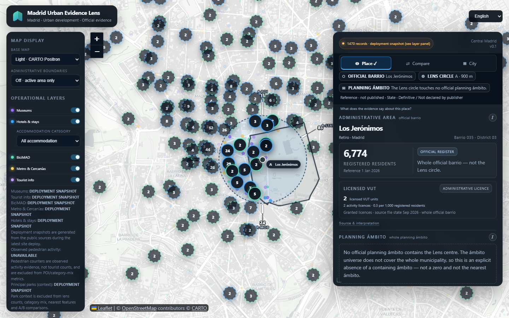
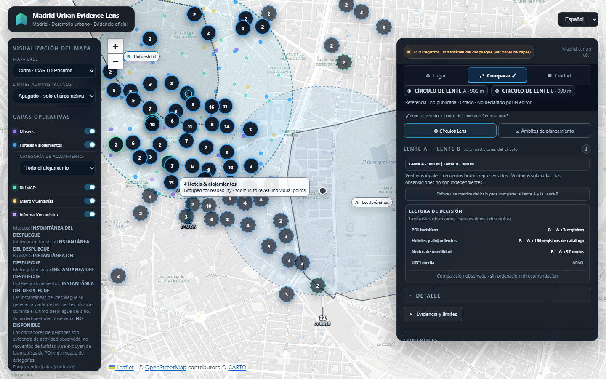

# UX-T1 T-a4 — bounded map-chrome decision

**Decision: GO for the scoped T-a4 implementation Draft PR [#110](https://github.com/soroushkarahrodi79-oss/madrid-tourism-intelligence-lens/pull/110).** This report resolves the map-chrome ownership and candidate-token questions. It does not activate an appearance or claim full WCAG conformance. Evidence PR [#109](https://github.com/soroushkarahrodi79-oss/madrid-tourism-intelligence-lens/pull/109) remains documentation and capture tooling only; issue [#102](https://github.com/soroushkarahrodi79-oss/madrid-tourism-intelligence-lens/issues/102) is open and unchanged.

## Preflight and source boundary

- The reviewed production snapshot, deployed Pages manifest, and `origin/main` match `9a7d2f20debdffce0823bbca81850060069ccb4d`.
- PRs [#107](https://github.com/soroushkarahrodi79-oss/madrid-tourism-intelligence-lens/pull/107) and [#108](https://github.com/soroushkarahrodi79-oss/madrid-tourism-intelligence-lens/pull/108) are merged. Their post-merge [test run](https://github.com/soroushkarahrodi79-oss/madrid-tourism-intelligence-lens/actions/runs/39453284177) and [Pages run](https://github.com/soroushkarahrodi79-oss/madrid-tourism-intelligence-lens/actions/runs/39453284122) passed. The pinned deployed manifest SHA-256 is `ee5307fbb9ed31a2ffc440b070b2e60d53861084d37b4194612bb12a8365d071`.
- PR #109 was reviewed at `b30066e1a15fe20b93b2c16708b96d22ab260cbf`. It remains a documentation/evidence branch. Issue #102 was not edited.
- Read Phase A §§2.4, 10 T-a4, and 13; K5 in [VISUAL_LANGUAGE.md](VISUAL_LANGUAGE.md); the [T-a0 ownership evidence](../research/ux_t1_ta0_minimum/README.md); and the [T-a3 decision](UX_T1_TA3_DECISION.md), [implementation](UX_T1_TA3_IMPLEMENTATION.md), and [capture evidence](../research/ux_t1_ta3_palette/README.md). T-a0 through T-a3 remain the completed baseline.

The capture harness fails if the deployed manifest, app assets, or POI data differ from that snapshot. New captures go to a unique staging directory; provenance and each required PNG signature, dimensions, and SHA-256 are checked before promotion. A failed validation leaves the last verified `capture-current` package in place. [The package test](../tests/capture_package.test.mjs) covers wrong-source and wrong-image-hash rollback.

## Scoped ownership

| Consumer | Owner and boundary |
|---|---|
| `#map`, `.leaflet-container` fallback | Application fallback only. Leaflet owns the container implementation; providers own loaded tile pixels, labels, and attribution content. The fallback is visible only where tiles do not cover the surface. |
| `.leaflet-control-attribution` and links | The application owns plate color, text/link colors, width, and persistent link underline. Leaflet supplies attribution strings and URLs. Link focus uses the existing shared T-a2 focus treatment. |
| `.leaflet-control-zoom` and anchors | The application owns surface, foreground, separator edge, hover surface, shadow, dimensions, placement, and disabled-state appearance. Leaflet supplies the control, accessible labels, disabled class, and `aria-disabled` state. The internal separator is the only border set by the app's `border-color`; the outer boundary sits against variable map imagery. |
| `.leaflet-tooltip` and `.leaflet-tooltip-top:before` | The application owns tooltip surface, text, border, shadow, and the top-arrow color. Leaflet owns triggering, placement, and arrow geometry. Bottom/left/right arrows remain Leaflet defaults and are outside this evidence. |
| `.area-label`, `.area-label-b` | Application-owned A/B map labels, separate from T-a3 center markers and halos. Label text carries A/B identity; the surface and edges improve separation from tiles. |
| `:focus-visible` | Shared T-a2 role. T-a4 reuses `--chrome-focus-ring-color` and `--chrome-focus-separation-color`; it adds no map-specific focus system. |

No basemap provider or tile, `LENS_BASEMAP_STYLES`, marker/category color, center-marker/halo color, geometry, pane order, HATI, or map interaction was changed. Appearance stays independent of basemap choice. Light values remain behind the existing dormant `:root[data-appearance="light"]` selector; normal startup still sets no appearance attribute.

## Minimum token plan

“Existing Dark” records the shipped application values. One intentional attribution foreground correction and one disabled-state correction are described below; all other Dark values are preserved. Light values are the rendered candidates used by the implementation Draft.

| Current selector/state | Owner | Existing Dark value | Semantic token(s) | Light candidate | Acceptance check |
|---|---|---|---|---|---|
| `#map`, `.leaflet-container` fallback | Application | `#09111c` | `--map-fallback-surface` | `#f4f6f9` | Only fallback changes; loaded tiles and basemap selection remain unchanged. |
| `.leaflet-control-attribution` plate and text | App style; provider content | `rgba(5,8,12,.75)` / `#8798ab` | `--map-attribution-surface`, `--map-attribution-text` | `rgba(255,255,255,.92)` / `#445468` | Normal text ≥4.5:1 on the three sampled basemap renders. Dark text intentionally changes to `#aab9ca` to fix its 3.31:1 Light-basemap sample. |
| Attribution links, hover, focus | App color; T-a2 focus | `#b9c7d7`; previously underlined on hover/focus | `--map-attribution-link`; shared focus tokens | `#0a63c7`; underline at rest and hover | Link ≥4.5:1 and remains structurally distinct without hover. Focus stays 2px ring / 3px offset / 1px separation. |
| `.leaflet-control-zoom a`, hover, separator, shadow | Application styling over Leaflet control | `#0b1521` / `#fff` / `#25364a`; hover `#0b1521`; `0 8px 24px rgba(0,0,0,.24)` | `--map-zoom-surface`, `--map-zoom-text`, `--map-zoom-edge`, `--map-zoom-hover-surface`, `--map-zoom-shadow` | `#fff` / `#16222f` / `#74808e`; hover `#f2f4f7`; `0 8px 24px rgba(16,24,34,.18)` | The internal separator candidate is 4.02:1 against the white button and 3.65:1 against its hover fill. Plus/minus glyphs and keyboard focus identify the controls; no contrast claim is made for an outer edge against arbitrary tiles. |
| `.leaflet-control-zoom a.leaflet-disabled` | Leaflet state; app styling | App `!important` colors masked Leaflet's default gray disabled colors, so baseline inactive and active states looked alike | `--map-zoom-disabled-text`, `--map-zoom-disabled-opacity` | `#667586`, opacity `1` | Real minimum-zoom state exposes `.leaflet-disabled` and `aria-disabled="true"`; a pointer click does not zoom and zoom-in restores the active state. Light text is 4.28:1 on hover fill; the inactive-component exception applies. Dark uses white text with opacity `.56` to repair the masked state. |
| `.leaflet-tooltip`, top arrow | App surface/text/border; Leaflet placement/shape | `#09131f` / `#fff` / `#31465d`; arrow `#31465d`; `0 10px 28px rgba(0,0,0,.4)` | `--map-tooltip-surface`, `--map-tooltip-text`, `--map-tooltip-edge`, `--map-tooltip-arrow`, `--map-tooltip-shadow` | `rgba(255,255,255,.96)` / `#16222f` / `#74808e`; arrow `#74808e`; `0 10px 28px rgba(16,24,34,.18)` | Text is 11.96–12.16:1 in real tooltip-surface samples. The arrow is a redundant pointer-to-feature cue: hover remains on the visible feature. Preserve its position and shape; its Light sample is only 2.17:1 against one adjacent tile/marker composite, so it is not accepted as an essential cue over heterogeneous imagery. |
| `.area-label`, `.area-label-b`, B text | App map-label chrome; not T-a3 markers | `rgba(9,18,30,.9)` / `#e8f0fa` / `rgba(178,203,228,.42)`; shadow `0 6px 18px rgba(0,0,0,.45)`; B edge `rgba(67,215,255,.45)`, B text `var(--ta3-lens-b-text)` = `#43d7ff` | `--map-label-surface`, `--map-label-text`, `--map-label-edge`, `--map-label-shadow`, `--map-label-b-edge`, `--map-label-b-text` | `rgba(255,255,255,.94)` / `#16222f` / `#74808e`; shadow `0 6px 18px rgba(16,24,34,.16)`; B edge/text `#00718f` | Minimum-composite checks are 14.13:1 for label text and 4.90:1 for B text. A/B wording carries identity; the label edge is decorative. B was rendered once; no claim is made for every label/basemap combination. |

The disabled zoom opacity is a state-only correction: Leaflet's disabled gray `color` and `background-color` were overridden by the app's active `!important` declarations. The new disabled role makes the real inactive state perceivable while retaining Leaflet's class and accessibility state. The shared focus colors are unchanged.

## Bounded rendered evidence

The capture set uses the pinned production snapshot and live tiles. It covers the Dark attribution correction, simulated Light chrome, all three basemaps, one desktop and one mobile context, English and Spanish, keyboard focus, real zoom interactions, and an actual top-directed map-feature tooltip. This is not the final Phase B appearance × basemap × information-surface matrix.

| Capture | State |
|---|---|
| [Dark chrome / attribution correction preview](../research/ux_t1_ta4_map_chrome/capture-current/screenshots/01-dark-reference-desktop-en-light.png) | Desktop 1440×900, English, Light tiles; only the corrected attribution foreground/underline and disabled-state preview are injected. |
| [Simulated Light / Light basemap](../research/ux_t1_ta4_map_chrome/capture-current/screenshots/02-light-desktop-es-light-zoom-tooltip.png) | Desktop 1440×900, Spanish, COMPARE; zoom action and actual top tooltip over a hovered map feature; B label visible. |
| [Simulated Light / Dark basemap](../research/ux_t1_ta4_map_chrome/capture-current/screenshots/03-light-desktop-en-dark-attribution-focus.png) | Desktop 1440×900, English; actual tooltip and keyboard focus on the attribution link. |
| [Simulated Light / Satellite mobile](../research/ux_t1_ta4_map_chrome/capture-current/screenshots/04-light-mobile-es-satellite.png) | 390×844 emulation, Spanish, coarse pointer; actual Layers disclosure and Satellite selection; zoom targets 44×44 CSS px. |
| [Simulated Light / Satellite tooltip](../research/ux_t1_ta4_map_chrome/capture-current/screenshots/05-light-desktop-en-satellite-top-tooltip.png) | Desktop 1440×900, English; actual top tooltip over Satellite tiles. |

The metadata in [`capture-metadata.json`](../research/ux_t1_ta4_map_chrome/capture-current/capture-metadata.json) records production hashes, loaded tile counts, computed states, live-surface samples, and per-image hashes.

### Contrast results

K5's normal-text threshold is 4.5:1 and its essential non-text threshold is 3:1. Ratios below are bounded rendered or conservative surface samples, not a certification over all tile imagery.

| State | Rendered comparison | Result |
|---|---|---|
| Dark attribution before correction, Light tiles | `#8798ab` / `#424447` | 3.31:1 — fails normal text. |
| Dark attribution after correction, Light / Dark / Satellite tiles | `#aab9ca` over `#424447` / `#06080b` / `#040609` | 4.89:1 / 10.03:1 / 10.14:1 — passes these rendered samples. |
| Dark attribution links at rest, same samples | `#b9c7d7` over those same backgrounds | 5.68:1 / 11.66:1 / 11.80:1; the persistent underline is the additional link cue. |
| Light attribution, Light / Dark / Satellite captures | `#445468` and `#0a63c7` over modal rendered pixels `#fefefe` / `#fcfdfe` / `#fafaf8` | Text: 7.67:1 / 7.60:1 / 7.40:1. Links: 5.75:1 / 5.69:1 / 5.55:1. |
| Light tooltip text on Light / Dark / Satellite tiles | `#16222f` over `#dee0e1` / `#dddee0` / `#dedfe0` | 12.16:1 / 11.96:1 / 12.07:1. |
| Light zoom separator | `#74808e` against `#fff` and hover `#f2f4f7` | 4.02:1 / 3.65:1. |
| Light tooltip arrow | `#74808e` against adjacent rendered Light / Satellite samples `#434c56` / `#0d1520` | 2.17:1 / 4.56:1. The arrow is redundant with the live pointer-held feature; no 3:1 claim is made against variable tiles. |
| Light disabled zoom text | `#667586` on hovered `#f2f4f7` | 4.28:1; genuinely inactive controls are exempt from the 4.5:1 text requirement. State and no-op behavior are verified. |

## Remaining limits and gate

- Only top-directed POI/map-feature tooltips were exercised. Bottom/left/right arrows retain Leaflet defaults. The arrow's pointer association is verified, but tile contrast varies; it is treated as redundant rather than criterion-bearing.
- B area-label contrast was bounded by its surface and the B label was captured once; both A/B labels were not sampled over every basemap.
- Tile imagery is live and may change independently of the pinned app source. Browser coverage is Chromium desktop/mobile emulation, not physical iPad or Safari.
- No full Phase B Cartesian matrix was run. Reserve it for the appearance-activation gate.

**GO for the minimum T-a4 CSS/token implementation Draft PR.** The production Dark attribution foreground changes intentionally from `#8798ab` to `#aab9ca`; the attribution links are underlined at rest. Other Dark base values remain exact. The one state-only Dark disabled-zoom opacity correction (`.56`) repairs the previously masked disabled appearance. Light stays dormant until the appearance-activation gate. No merge or manual deployment is part of this decision.