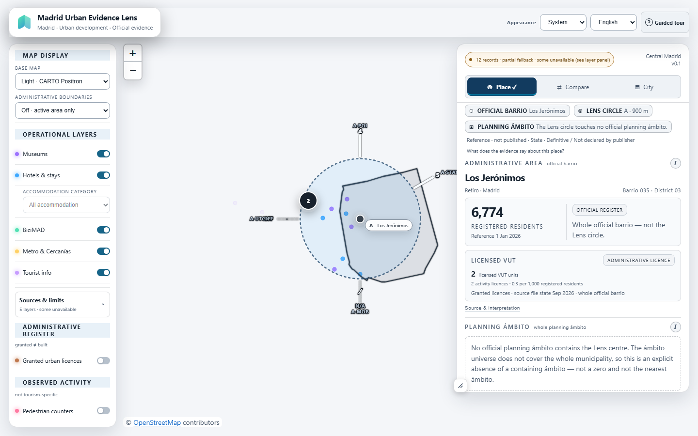
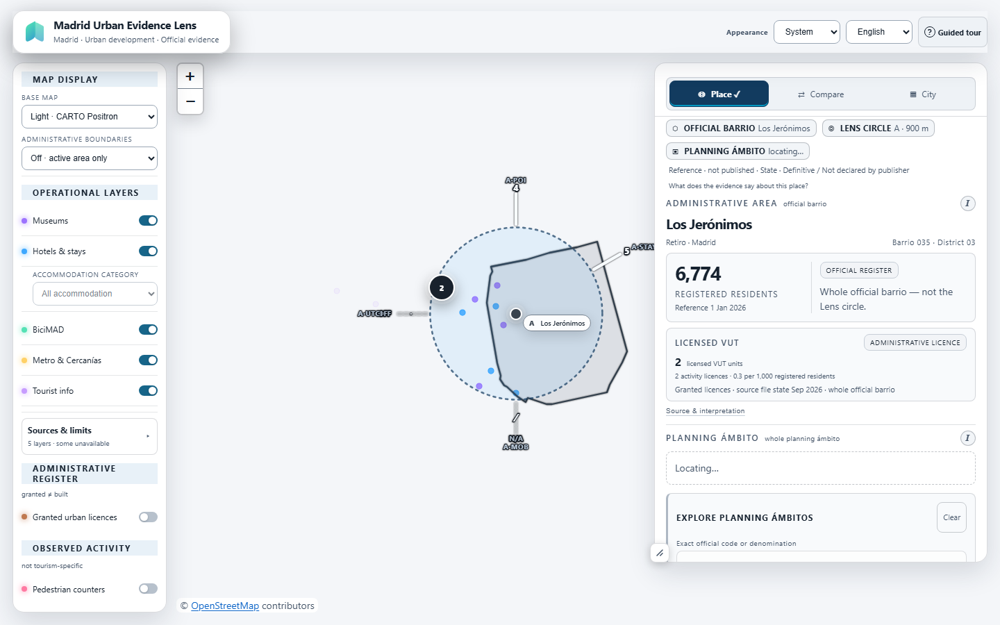
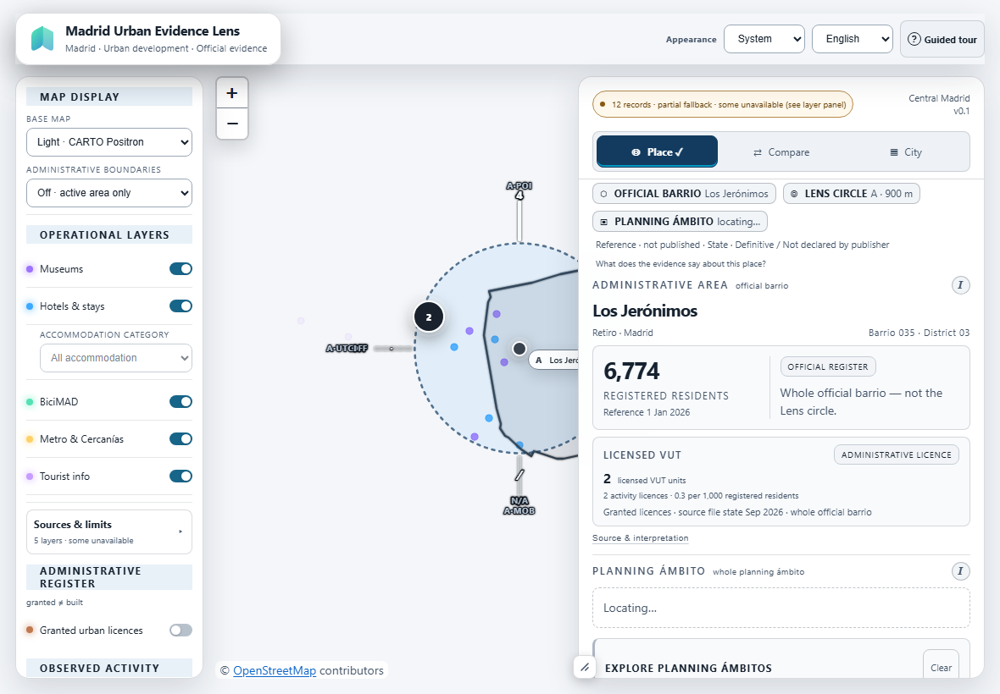
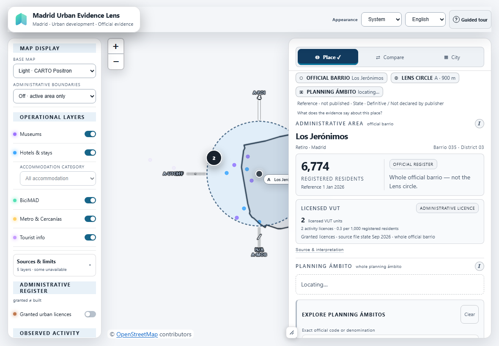
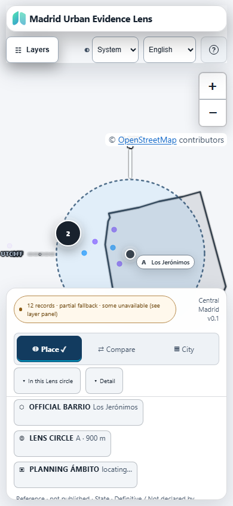
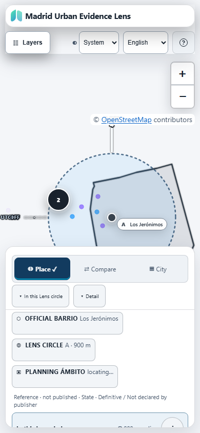
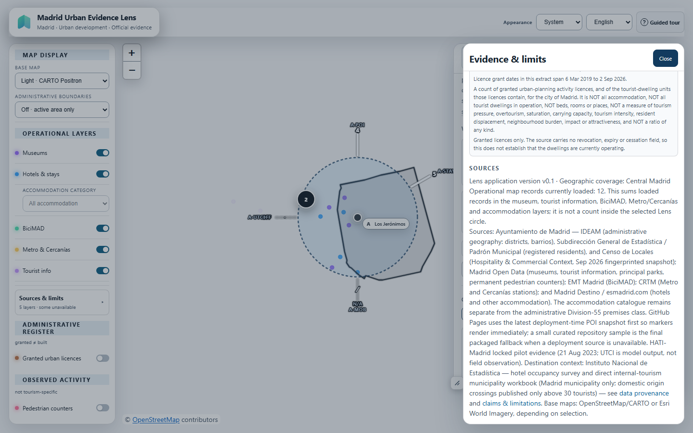

# Lens UX Fix 02 — deployment metadata banner

This compares the unchanged ffbcf14 base (origin/main, including PR #128) with this branch. Screenshots were captured at the listed CSS viewport sizes with Playwright.

The checkout has no generated deployment-time runtime_poi.json; the application therefore uses its packaged curated fallback for these captures. The evidence drawer shows the resulting loaded map record total and explicitly identifies its layer scope. It is a local fallback count, not the production deployment total and not the count within a selected Lens circle.

## Target viewport comparison

| Viewport | Before | After |
| --- | --- | --- |
| Desktop · 1440 × 900 |  |  |
| iPad landscape · 1180 × 820 |  |  |
| Mobile · 390 × 844 |  |  |

## Provenance access

The existing Evidence & limits drawer retains application version, geographic coverage, a dynamically generated count of loaded operational map records, and the explicit limitation that this is not the selected Lens-circle count. Source availability and curated-fallback completeness caveats remain in the layer panel.

