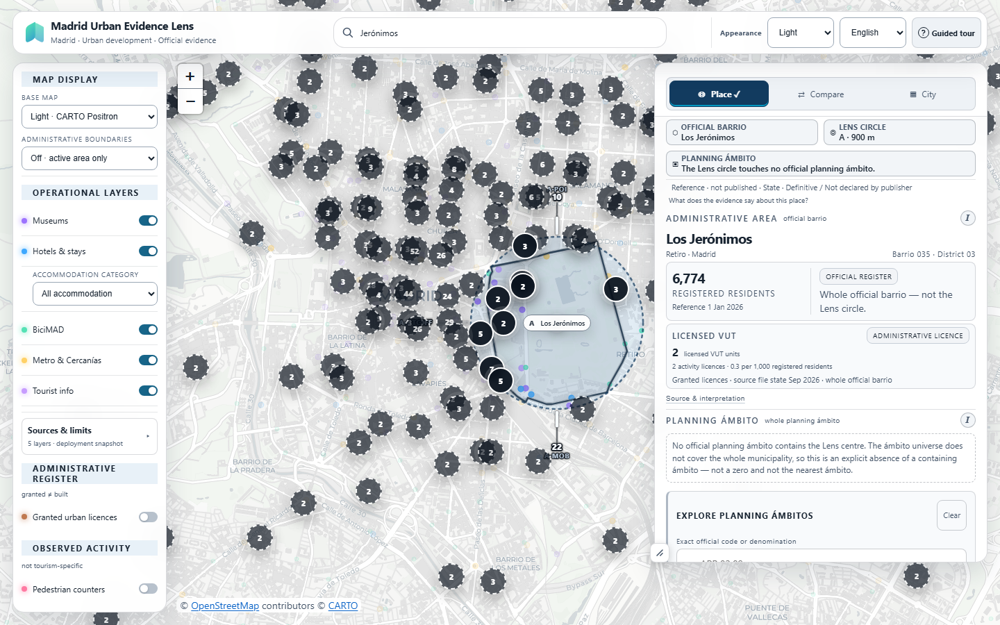
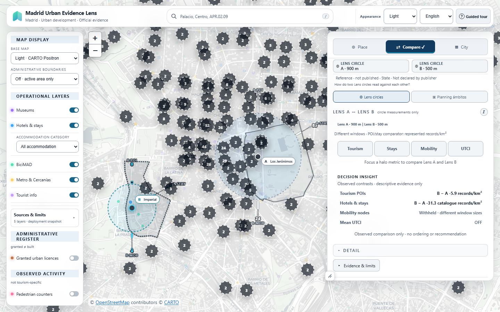
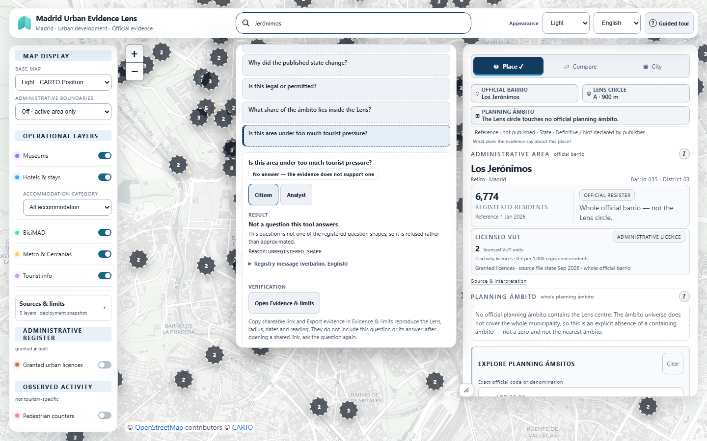
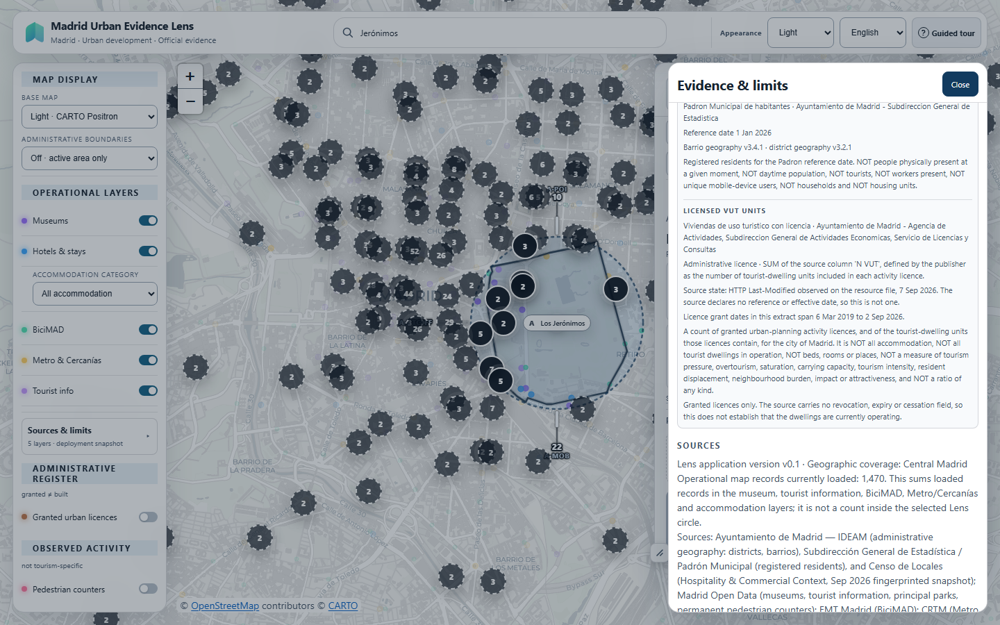

# Lens in action: evidence demonstration

These are screenshots of the production application, taken from one deployed build. The values that matter are repeated in text beside each image, so nothing important depends on reading small type inside a screenshot. Select an image to open the original file.

| | |
|---|---|
| Live application | <https://soroushkarahrodi79-oss.github.io/madrid-tourism-intelligence-lens/> |
| What the images show | Three readings: **Place**, **Compare**, **Evidence** |

## 1. Place

**Los Jerónimos, official barrio 035 (Retiro).** Selected through Civic Search, then analysed with a 900 m Lens circle.

| Reading | Value | Scope | Date |
|---|---|---|---|
| Registered residents | 6,774 | Whole official barrio | Reference 1 Jan 2026 (Padrón) |
| Licensed VUT units | 2 (0.3 per 1,000 registered residents) | Whole official barrio | Source file state Sep 2026 |

**Limits.**

- Both figures describe the whole official barrio, not the Lens circle. A barrio statistic is never distributed into the circle.
- A licence is not a dwelling, and a granted licence does not show that a dwelling is operating as tourist accommodation.
- The per-1,000 figure is a descriptive ratio of two administrative facts from different periods. It is not a rate and not a share of homes.

## 2. Compare

**Lens A, 900 m, and Lens B, 500 m, in separate places.** The windows do not overlap.

| Reading | Result |
|---|---|
| Tourism points of interest | B − A: −5.9 records/km² |
| Hotels & stays | B − A: −31.3 catalogue records/km² |
| Mobility nodes | **Withheld: different window sizes** |

**Limits.**

- The two density rows compare represented records per km², which is why unequal radii are allowed for them. The mobility comparison is withheld rather than approximated because the window sizes differ.
- This is an observed comparison only. Lens gives no ordering and no recommendation, and a density difference is not a measure of tourism pressure or of quality.
- Accommodation records come from a promotional tourism catalogue, not from a register.

## 3. Evidence

**A justified refusal.** The question is not one of the registered question shapes, so Lens refuses it instead of approximating an answer. The refusal reason shown is `UNREGISTERED_SHAPE`.

**Evidence & limits.** For each figure on screen the drawer lists its authority, reference date, retrieval date and interpretation ceiling. For VUT units it states that the source holds granted licences only, with no revocation, expiry or cessation field, so nothing is established about dwellings currently operating.

## Capture provenance

| | |
|---|---|
| Deployed commit | `77505435579299f2fd1d2de0bb5e7213bd39f1ad` |
| Deployment manifest | Build state `pass`, 0 errors, 0 warnings, 19 of 19 layers available, generated 2026-11-01T23:11:56Z |
| Captured | 1 November 2026, Chromium driven by Playwright, 1440 × 900, light appearance, English |
| Basemap | CARTO Positron. Map attribution (© OpenStreetMap contributors © CARTO) is visible in every full screenshot, and 24 of 24 tiles loaded in each capture |
| Layers | Default layers; no layer was switched off |
| Presentation choices | Light appearance; guided-tour prompt dismissed; place-finder list dismissed in the Place image |
| Image files | Lossless WebP, pixel-identical to the original PNG captures. The screenshots are otherwise unedited |
| Cover | `showcase/lens-cover.webp` is an editorial composition: one complete Compare screenshot, scaled to 69%, with editorial text beside it. It is not an unmodified screenshot |
| Checksums and per-frame checks | [`showcase/capture-manifest.json`](showcase/capture-manifest.json) |

The Place and Compare images were captured in one session and the two Evidence images in a second session shortly afterwards. Both sessions used the same deployed commit.

## Sources and method

- [Product semantics](PRODUCT_SEMANTICS.md): the terms used on screen (scope, freshness, interpretation ceiling)
- [Claims and limitations](CLAIMS_AND_LIMITATIONS.md)
- [Data provenance](DATA_PROVENANCE.md) and the [source registry](../data/source_registry.json)
- [Comparison Bridge](COMPARISON_BRIDGE_V1.md) and [Decision Insight](DECISION_INSIGHT_V1.md): how comparisons are read, and when they are withheld
- [Evidence export](EVIDENCE_EXPORT.md): how a reading is reproduced and exported
