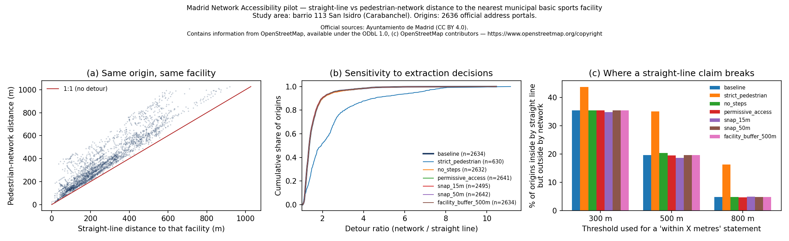

# Madrid Network Accessibility pilot — results and verdict

Measured on **2026-11-16**; revised the same day after a methodological review
(§7). The design, the sources and every documented decision are in
[`README.md`](README.md); the machine-readable record of this run is
[`results/pilot_report.json`](results/pilot_report.json).

**On the status of the design.** The design constants and the acceptance
criteria were written into `run_pilot.py` while the pipeline was built and
before its output was examined, but this package holds **no independent
timestamped record** proving that order. They are therefore **documented
retrospectively**, and nothing here is pre-registered. The weaker claim that
*is* verifiable: the study-area rule and the criteria depend only on the
sources, never on a distance or a ratio, so they could not have been fitted to
an outcome — an argument from their inputs, not from their date.

> **Verdict: MODIFY**, with conditions. The experiment is defensible and its
> finding is real, but it does not yet license a Lens feature. §[Verdict](#verdict-modify)
> states exactly what may and may not be carried forward.

Research only. Nothing here is wired into the application, no `data/` artifact
was produced, and no branch, PR, merge or deployment was touched.

---

## 1. What was measured

| | |
|---|---|
| **Study area** | barrio **113 San Isidro**, district Carabanchel — 1.8993 km², perimeter 6 149.6 m |
| **Origins** | **2 651** official address portals (`TIPO_NDP = PORTAL`), selected from 214 294 current callejero rows |
| **Facilities** | **38** distinct access points of *Instalaciones Deportivas Básicas Municipales* within 1 000 m of the barrio boundary (10 of them inside it), from 606 citywide records |
| **Network** | OpenStreetMap, Overpass extract of the barrio + 1 600 m; 17 665 `highway` ways retrieved, **16 715 retained**, 66 181 nodes / 77 399 segments, **1 290.4 km** of retained walking network |
| **Metric CRS** | EPSG:25830 (ETRS89 / UTM 30N) throughout |

The study-area selection rule was applied in the open and **agreed with the
barrio declared in the code** (`rule_agrees_with_declaration: true`). The next
two candidates were Moscardó (125, 9 access points) and Legazpi (024, 9).

### Data-quality checks that the run performed on its inputs

| Check | Result |
|---|---|
| Portals whose callejero barrio code names the study barrio **and** fall inside the official barrio polygon | **2 651 / 2 651** — the two official products agree completely |
| Duplicate `COD_NDP` in the selected set | **0** |
| Facility records in the catchment without published coordinates | **0** |
| Facility rows collapsing onto a shared coordinate | **0** (38 rows → 38 access points here; the collapse rule still applies elsewhere) |
| OSM ways with unresolvable node references | **0** |

Ways were rejected for auditable reasons, not silently: 333 `access_denied`,
211 `foot_denied`, 139 `motorway_link`, 102 `motorway`, 73 `construction`,
42 `corridor`, 12 `raceway`, 12 `bus_stop`, 9 `indoor`, 7 `proposed`,
3 `trunk`, 3 `ladder`, 2 `elevator`, 1 `rest_area`, 1 `services`.
118 `area=yes` ways were kept as closed rings.

---

## 2. Acceptance criteria — all four pass

| # | Criterion | Threshold | Observed | |
|---|---|---|---|---|
| **A1** | origins snapping within the 30 m tolerance | ≥ 95 % | **99.66 %** | **PASS** |
| **A2** | pairs whose network distance falls below the straight line | 0 | **0**, across all seven variants | **PASS** |
| **A3** | origins unmeasurable (not snapped or unreachable) | < 5 % | **0.57 %** (9 not snapped, 6 unreachable) | **PASS** |
| **A4** | median detour ratio stays above 1 in every variant | all | 1.347 – 1.922 | **PASS** |

Connectivity, measured on the graph the paths actually run on: 83 components,
largest holding **98.95 %** of nodes. Snap offsets are small and well behaved —
median **6.05 m**, p95 **15.20 m**, p99 **20.90 m** — which is what a portal-to-
pavement walk should look like and is itself evidence that the snapping is not
inventing distance.

---

## 3. Results

### 3.1 The straight line understates the walk, substantially

Over the 2 636 measured portals:

| | p5 | p25 | **p50** | p75 | p95 | p99 |
|---|---|---|---|---|---|---|
| Straight-line distance to nearest facility (m) | 58.1 | 135.6 | **224.1** | 379.4 | 560.6 | 660.7 |
| Pedestrian-network distance to nearest facility (m) | 104.7 | 210.4 | **340.8** | 530.1 | 794.4 | 954.9 |
| **Detour ratio** (same origin, same facility) | 1.121 | 1.219 | **1.354** | 1.618 | 2.477 | 4.369 |

Mean detour ratio **1.538** over the 2 634 pairs where a ratio is defined.
Understatement in metres (network distance to the network-nearest facility minus
straight-line distance to the straight-line-nearest facility): **median 98.1 m**,
**mean 118.9 m**. Measured to the *same* facility, the extra walking is a median
of **87.3 m**.

**H0 is rejected.** The typical portal in San Isidro is about **100 m further**
from its nearest basic sports facility on foot than the straight line says, the
median walk is **1.35×** the straight line, and the ratio is strongly
heterogeneous: a twentieth of portals face a detour of **2.51× or worse**. (The
two medians in the table above differ by 116.7 m, which is not the same quantity
as the median of the per-portal differences and is not reported as such.)

#### The ratio denominator, audited

A ratio needs a denominator larger than the precision of the coordinates it
comes from, so ratios are reported only for pairs at least **1 m** apart — the
precision bound of the inputs (facility register: WGS84 to 7 decimals, ~1.1 cm;
callejero: UTM to the centimetre).

| | |
|---|---|
| Measured pairs | 2 636 |
| Pairs with a reported ratio | **2 634** |
| Pairs excluded by the bound | **2** |
| Pairs with an exactly zero denominator | **0** |
| Smallest denominator in the data | 3.64 × 10⁻⁷ m (0.36 µm) |
| Smallest **retained** denominator | **6.64 m** |

The two excluded pairs are not mathematically undefined — no division by zero
occurs — but their denominators are **sub-micron**: the register publishes those
two facilities at the portal's own published coordinate, which is what
address-derived geocoding produces when a facility shares a portal's address.
Their network distances are 8.96 m and 22.64 m, so each would yield a short walk
divided by a rounding artefact. That is a number, and it is meaningless.

**The bound does not drive the result.** Between the excluded separations
(~10⁻⁵ m) and the smallest retained one (6.64 m) there is an empty interval
spanning six orders of magnitude, so the bound falls in a gap rather than
cutting through the data. Recomputing with the 25 m bound an earlier draft of
this pilot used gives a median of **1.3537** over 2 616 pairs, against **1.3545**
over 2 634 — a difference of **0.0008**, two orders of magnitude smaller than
the effect being reported. The 25 m bound was an over-correction: not wrong, but
doing more work than the data justify. Both figures are in
`ratio_denominator_rule`.

Excluded pairs stay in full in the distance-in-metres statistics, where they
remain valid.

### 3.2 The straight line also names the wrong facility, one time in five

For **21.05 %** of measured portals the facility that is nearest in a straight
line is **not** the facility that is nearest on foot. This is not a magnitude
error that a correction factor could absorb — it is the wrong answer to "which
one is closest".

The denominator is **measured origins (2 636)**, not all selected origins: a
portal that could not be snapped or could not be reached has no network answer
to agree or disagree with. Over all **2 651** selected origins the same 555
disagreements are **20.94 %**. Both bases are in the report so neither figure
can be quoted without it.

### 3.3 Where a "within X metres" claim breaks

This is the decision-relevant result.

| Threshold | Inside by straight line | Inside by network | Straight line in, network out | **False inclusion** (of straight-line-inside) | (of all 2 636 measured) |
|---|---|---|---|---|---|
| **300 m** | 1 737 | 1 123 | 614 | **35.35 %** | 23.29 % |
| **500 m** | 2 374 | 1 909 | 465 | **19.59 %** | 17.64 % |
| **800 m** | 2 636 | 2 510 | 126 | **4.78 %** | 4.78 % |

**The denominators.** The false-inclusion rate is over *origins the straight line
places inside that threshold* (1 737 / 2 374 / 2 636), not over all measured
origins; the last column gives the other base so the two are never confused.

**There is no symmetric error to report.** The straight-line distance to the
straight-line-nearest facility can never exceed the network distance to the
network-nearest facility — verified with 0 exceptions in 2 636 rows — so the
network-inside set is necessarily a **subset** of the straight-line-inside set.
"Network says inside, straight line says outside" is **0 at every threshold by
construction, not by coincidence**, which is why the error is one-directional
and why `within_by_network` and `within_by_euclid_and_network` are equal.

A statement of the form *"this address is within 300 m of a municipal basic
sports facility"*, made on straight-line distance, is **wrong for more than a
third of the portals it covers** in this barrio. At 800 m the error is small —
circuity is amortised over longer walks — which is exactly why the error is
largest at the short, neighbourhood-scale thresholds where such claims are
usually made.

*(a)* every measured portal against the 1:1 line; nothing falls below it.
*(b)* the cumulative detour-ratio distribution for all seven variants — six are
indistinguishable, one is not. *(c)* the false-inclusion rate by threshold.

### 3.4 Sensitivity: one decision matters, six do not

| Variant | Measured | Median detour | Δ vs baseline | Median network (m) | Δ (m) | Discordance |
|---|---|---|---|---|---|---|
| **baseline** | 99.43 % | 1.3537 | — | 340.8 | — | 21.05 % |
| `no_steps` | 99.36 % | 1.3543 | +0.0006 | 341.2 | +0.4 | 21.18 % |
| `permissive_access` | 99.70 % | 1.3539 | +0.0002 | 340.6 | −0.2 | 21.11 % |
| `snap_15m` | 94.19 % | 1.3474 | −0.0063 | 335.1 | −5.8 | 21.43 % |
| `snap_50m` | 99.74 % | 1.3533 | −0.0004 | 341.7 | +0.8 | 20.99 % |
| `facility_buffer_500m` | 99.43 % | 1.3537 | 0.0000 | 340.8 | 0.0 | 21.05 % |
| `strict_pedestrian` | **23.84 %** | 1.9222 | +0.5685 | 336.7 | −4.1 | 14.72 % |

Five of the six variants move the median detour ratio by **less than 0.007** and
the discordance share by **less than 0.4 points**. The finding does not depend
on the step-free assumption, on the access-restriction rule, on the snapping
tolerance, or on the facility catchment.

`facility_buffer_500m` reproduces the baseline **exactly** (seeded facilities
drop from 38 to 20, every nearest-facility answer is unchanged). That is a clean
demonstration that the 1 000 m catchment already absorbs the edge effect, so the
result is not a boundary artefact.

### 3.5 `strict_pedestrian` is a failed measurement, not a rival estimate

Its median detour ratio of 1.92 must **not** be read as "the real answer if you
only walk on pedestrian ways". Restricting the extract to ways tagged as
pedestrian space:

- leaves only **733.7 km** of the baseline's 1 290.4 km,
- fragments the network into **358** components with the largest holding only
  **87.66 %** of nodes,
- leaves **1 754 of 2 651 portals unable to snap at all** and 265 more
  unreachable,
- and therefore measures only **23.84 %** of the origins — failing this pilot's
  own A1 (≥ 95 %) and A3 (< 5 %) criteria by a wide margin.

The substantive finding is about the **data, not the city**: in San Isidro,
OpenStreetMap largely does not map pavements as separate `footway` geometry;
walking is represented by the carriageway centrelines of residential and
distributor streets. Including those in the baseline is therefore a necessity,
not a convenience — and the 1.92 figure is the circuity of a sparse, broken
subgraph serving the quarter of portals that happen to sit beside a tagged
pedestrian way.

This is the single most important methodological caution the pilot produces:
**OSM pedestrian completeness is spatially uneven and must be audited per area
before any network-accessibility figure is believed.**

---

## 4. Evidence of testing

`python -m unittest tests.test_network_accessibility_pilot` — **26 tests, all
passing.** They are not smoke tests; they check the primitives whose silent
failure would make the numbers wrong rather than merely imprecise:

- **Shortest paths against closed form.** Distances on a regular 100 m grid must
  equal the L1 distance, and the detour ratio between opposite corners must
  equal exactly √2. Both are asserted against the mathematics, not against a
  previous run of the code under test.
- **Multi-source behaviour** — the nearer seed wins, a seed's initial cost is
  carried, equidistant seeds break ties identically regardless of insertion
  order, and unreachable nodes receive no distance at all.
- **Snapping geometry** — the offset is the perpendicular distance, the inserted
  node lies on the segment, splitting a segment **preserves total edge length**,
  two points on one segment stay connected at the correct separation, a point
  beyond tolerance is *reported* rather than attached, and the whole result is
  **independent of input order**.
- **The geometric invariant**, asserted on known data as well as on the real run.
- **CRS** — a real published Madrid portal coordinate round-trips
  EPSG:25830 ↔ EPSG:4326 within **1 mm** and lands in Madrid.
- **Cache behaviour**, which is a reproducibility property rather than a
  performance one: a cache hit must serve the stored bytes **without a network
  call** (asserted by replacing the HTTP helper with one that raises) and must
  report the provenance of the **first** retrieval, so a re-run can never
  silently relabel where the bytes came from. The `PILOT_CACHE` override is
  checked too.
- **Isolation** — no file in `js/`, `index.html` or `package.json` references
  this package, and `pilot_common` imports no third-party module at module
  level, so it stays collectable in the repository's stdlib-only CI.

These tests found a real defect before any result was produced: heterogeneous
node keys (OSM integer ids against `("snap", pid)` tuples) reaching the heap
comparison in the Dijkstra, which raised `TypeError` whenever cost and label
tied. It was fixed with a monotonic counter that can only break a tie in which
the answer already agrees.

The repository's full Python suite and the `data` / `deployment_validation`
Node tests were run after the change; see §6.

---

## 5. Limitations

**Of the design.**

- **One barrio, one facility category.** Nothing here generalises to Madrid, to
  other barrios or to other facility types. The detour ratio depends on street
  morphology and on how facilities are distributed, and this pilot measured one
  configuration of both. It has **no evidence about any other barrio** — not
  about whether their ratios are higher or lower, and not about which
  morphologies differ from this one. Any such statement would be an assumption
  wearing a result's clothes.
- **A selection effect, recorded as one.** The study-area rule selects the
  *best-served* eligible barrio on the facility count it ranks by. That is a
  property of the sample and it is stated. What it implies for less-well-served
  barrios is **unknown here**: this pilot did not measure one, so it cannot say
  whether 1.354 is a floor, a ceiling or neither, and it does not.
- The facility register publishes **one row per sub-installation**, so a record
  count from it is not a count of installations.

**Of the network.**

- OpenStreetMap is **volunteered data of unknown and spatially uneven
  completeness**, not a municipal pavement cadastre. §3.5 shows how severe that
  unevenness is here.
- Including carriageways means the measured path is a street **centreline**,
  not a pavement. It ignores which side of the street the walk is on, and it
  assumes crossings are possible where OSM does not say otherwise.
- `area=yes` plazas are traversed **around** their ring, not across, so plaza
  distances are upper bounds.
- **The extract is a snapshot of a live, continuously edited database, and it is
  not archived.** Its data vintage is now recorded explicitly: Overpass reports
  `timestamp_osm_base = 2026-11-16T17:20:19Z` (generator *Overpass API
  0.7.62.11*, 87 364 elements), which — not the retrieval time — is the state of
  the database this answer was computed against.

  What that buys, and what it does not:

  | | |
  |---|---|
  | Reproducible **given the cached extract** | every figure: the payload SHA-256 is recorded, the filtering, graph construction, snapping and shortest paths are deterministic, and all seven variants re-filter the same bytes |
  | **Not** reproducible once the cache is gone | the raw extract is deliberately not committed, so re-running answers against a *later* state of a continuously edited database, returns different bytes and a different SHA-256, and moves the figures by an unknown amount |
  | Partial mitigation | `timestamp_osm_base` identifies the state, and Overpass supports attic queries against a past date — the route a reader would take to approach it again. This pilot **records the timestamp; it did not test an attic re-retrieval** and does not claim one would reproduce these bytes |
  | No HTTP validators | the request is a POST, so no `ETag` or `Last-Modified` is returned; the payload SHA-256 is a fingerprint of the *answer*, not of any upstream file |

  The official sources do not carry this limit: the callejero and facility
  registers are published editions whose resource URLs and SHA-256 are recorded
  and which can be retrieved again. The OSM side is the one that cannot.

**Of the measure itself.**

- It is **distance along a mapped network**. It is **not** travel time, not
  perceived walkability, not comfort, not safety, not slope-adjusted effort, and
  **not accessibility for a wheelchair user or a person with reduced mobility**.
  The `no_steps` variant is a crude step-free proxy, not an accessibility audit.
- **Every path ends at a published coordinate, not at a verified entrance.** The
  register's geocoding is address-derived, not surveyed — two facilities are
  published sub-micron distances from a portal's own coordinate (§3.1), which is
  what address-derived geocoding looks like. Where a real entrance sits elsewhere,
  the reported distance differs from the walk a person would make by an amount
  this pilot cannot bound. It carries no opening hours either.
- **The snap offset is modelled, not observed.** It is a straight connector from
  a published coordinate to the nearest retained segment. It is not an observed
  walk, not a surveyed path, and not evidence that any way exists along that
  line. It is included in the reported metres because omitting it would
  understate the distance — not because it was measured on the ground. Its
  median is 6.05 m, so it is a small part of a typical 341 m figure, but it is
  a modelled part.
- It says nothing about whether a facility is open, usable, in repair, or of any
  quality, and it is not a service-level or provision statement.

**Of the relation to Lens.** A Lens observation circle is a **declared
observation window** over published records. A network distance is a **measured
property of a street network**. They are different objects. This pilot does not
turn the Lens circle into an accessibility measure; §6 explains that it does the
opposite.

---

## 6. Verdict: **MODIFY**

The experiment is defensible — all four documented criteria pass, the
geometric invariant holds everywhere, and the finding survives every variant
that is itself a valid measurement. But it does not license a Lens feature as it
stands.

### What is already adoptable, at no data cost

The pilot's **negative** result is the immediately useful one, and it needs no
new source, no new artifact and no new dependency:

> Measured evidence that a radial distance is not a walking-distance statement.
> In this barrio, a "within 300 m" claim made on straight-line distance is wrong
> for 35 % of the addresses it covers, and the straight line names the wrong
> nearest facility for 21 % of them.

`docs/CLAIMS_AND_LIMITATIONS.md` and `docs/PRODUCT_SEMANTICS.md` already keep
the Lens circle away from accessibility language. This pilot converts that
correct design decision from a principled assertion into a **measured** one. The
recommended change is a documentation change only, citing this package — and it
is **recommended, not made here**, because amending a claims contract is a gated
decision that belongs to its owner, not to a research pilot.

> **Update 2026-11-21.** A bounded bullet reproducing the 500 m figures
> (465 / 2 636, scoped to this barrio) was subsequently proposed in
> `docs/CLAIMS_AND_LIMITATIONS.md`, with its owner's review pending. The
> measurements, criteria and verdict in this file are unchanged.

### What a positive feature would require first — five conditions

1. **An OSM completeness audit per area, as a gate.** §3.5 shows that
   pedestrian-way completeness, not the algorithm, is the binding constraint and
   that it varies enormously. Publishing a network distance for an area whose
   OSM completeness is unaudited would be publishing an unknown.
2. **Replication across barrios chosen for contrast**, not for convenience —
   deliberately including barrios the present rule would *not* select, so the
   selection effect in §5 is tested rather than repeated. How many and which is
   a design question for that work; this pilot has no basis for naming them.
   A single-barrio figure must never be shown as a Madrid figure.
3. **A source gate for the facility register.** `200215` was *audited* here, not
   *adopted*. Adoption needs the repository's usual treatment: identity,
   taxonomy, status, temporal and geography findings, and an entry in
   `docs/DATA_PROVENANCE.md` — including the fact that a row is a
   sub-installation, not an installation.
4. **An ODbL review by someone qualified to give one.** The application is MIT
   with a documented licensing boundary. This pilot took the conservative route
   on both readings — it withholds the extracted OSM geometry *and* attributes
   OpenStreetMap on the derived outputs — but whether a derived distance table
   is a Produced Work or a Derivative Database under ODbL 1.0 is **contested,
   and this pilot did not settle it and is not competent to**. Nothing in this
   package is legal advice. Before anything OSM-derived ships, that question
   needs a real answer, not this pilot's precaution.
5. **A runtime decision.** This is a static browser application with known
   rendering ceilings (the K12 work). In-browser routing is out of the question;
   the only viable shape is a committed per-portal or per-area precomputed
   artifact with a declared network vintage, and its size and rendering cost
   must be measured before anything is promised.

### Why not GO, and why not HOLD

- **Not GO.** One barrio, one category, an unaudited and demonstrably uneven
  network source, and an unresolved licence and runtime shape. Shipping on this
  evidence would be exactly the kind of proxy-presented-as-the-thing the
  repository's integrity rules forbid.
- **Not HOLD.** HOLD would mean the data do not permit a defensible experiment.
  They plainly do: the sources are official and licence-clear, the two official
  products agree on 2 651 of 2 651 portals, 99.4 % of origins were measured, the
  geometric invariant never broke, and the finding is large, stable and
  decision-relevant.

**MODIFY** is the honest reading: a sound method and a real finding, usable
immediately in its negative form, and eligible for a product increment only
after the five conditions above are met.

### Explicitly not changed by this pilot

No existing PASS / HOLD / NO-GO gate decision is revisited. In particular the
Gate L **MODIFY** on unlicensed ArcGIS reuse stands and is the reason the metro
and Cercanías layers were not used here; the parks layer's context-only ceiling
stands and is the reason parks were not used; and the mobility-node ceiling in
`docs/CLAIMS_AND_LIMITATIONS.md` stands and is the reason BiciMAD was not used.

---

## 7. Revision note — methodological review, 2026-11-16

This section records what a post-hoc review changed, so a reader can see the
corrections rather than only their result. Nothing was re-downloaded: the review
re-ran the pipeline against the **same cached extract**, so every difference
below comes from a reporting or wording change, never from different data.

### Metrics before and after

| Metric | Before | After | Cause |
|---|---|---|---|
| Ratio denominator bound | 25 m | **1 m** (input precision) | the 25 m bound was an over-correction |
| Pairs with a reported ratio | 2 616 | **2 634** | 18 pairs between 1 m and 25 m restored |
| Median detour ratio | 1.3537 | **1.3545** | +0.0008 |
| Mean detour ratio | 1.527 | **1.538** | the 18 restored pairs |
| p95 detour ratio | 2.476 | **2.506** | the 18 restored pairs |
| Median understatement ratio | 1.3878 | **1.3880** | the 18 restored pairs |
| Pairs excluded | 20 | **2** | only the sub-millimetre ones |
| "Exactly coincident" pairs | reported as 2 | **0** (smallest denominator 3.64 × 10⁻⁷ m) | the old figure was computed on a value already rounded to 3 decimals |

**Unchanged:** every distance in metres (median straight line 224.1 m, median
network 340.8 m), the discordance share (21.05 %), every threshold figure
(35.35 / 19.59 / 4.78 %), all four acceptance criteria, the whole sensitivity
table, and the verdict. The corrections moved the headline ratio by 0.0008 and
changed no conclusion.

### Corrections that changed no number

| # | What was wrong | What it says now |
|---|---|---|
| 1 | OSMnx was described as disqualified because its default pipeline simplifies the graph | **Withdrawn as incorrect.** `simplify=False` is available and consolidation is opt-in; OSMnx is fully capable of this measurement. The real reasons are narrower and are about this package: not installed, would add the pilot's only new dependency tree, and the extraction rule had to stay visible in this package's own code because it is itself an object of study. If this work is extended, OSMnx with `simplify=False` is the sensible tool |
| 2 | The design was called "pre-registered" | **Documented retrospectively.** No independent timestamped record exists. The weaker verifiable claim — the rule's inputs contain no distance or ratio, so it could not have been fitted to an outcome — is what is now made |
| 4 | The snap offset was "added to the walk as real distance"; paths implied arrival at facilities | A **modelled straight connector** between a published coordinate and the network — not an observed walk and not evidence a way exists there. Paths end at **published coordinates, not verified entrances**, and the error from that is unbounded by this pilot |
| 5 | The ODbL split between Produced Work and Derivative Database was asserted | Stated as a **precaution, not a legal determination**. The boundary is contested for derived measurements; the pilot takes the conservative option on both readings and says so. Nothing here is legal advice |
| 6 | Morphological claims about Centro and Vallecas; "1.354 is more likely a floor" | **Removed.** The pilot measured one barrio and has no evidence about any other — not about direction, not about magnitude |
| 7 | The OSM data vintage was not recorded; reproducibility limits were vague | `timestamp_osm_base` is now read from the payload and reported, with an explicit statement of what is and is not reproducible once the git-ignored cache is gone |
| 8 | Shares were reported without naming their base | Every share now carries its denominator and, where a second base exists, that too (discordance: 21.05 % of 2 636 measured, 20.94 % of 2 651 selected). The one-directional nature of the threshold error is now stated as a **mathematical necessity**, verified with 0 exceptions |

Item 3 (the ratio denominator) is the metrics table above. A defect in the
corrected code was also caught and fixed before these figures were accepted: the
smallest denominator was being rounded to six decimals, printing a positive
sub-micron value as `0.0` and contradicting the zero-denominator count beside
it.

### What this review did not do

It did not extend the pilot, add a barrio, add a category, add an indicator, add
a dependency, re-download anything, or develop anything for Lens. The scope was
the existing experiment's methodology and nothing else.

---

## 8. Publishability review — ODbL, 2026-11-16

A second review, limited to the four OSM-derived artifacts, checked them against
the OpenStreetMap Foundation's published community guidelines before this work
could be shared. It changed **no measurement**: every figure in §1–§5 is
unchanged, all four acceptance criteria still pass, and the verdict is still
MODIFY. What it changed is what is published and what is said about it.

### What the review concluded

| Object | Reading | Published? |
|---|---|---|
| The Overpass extract and the filtered graph | **Derivative Database.** Systematic (`way[highway]` over the whole bbox), 17,665 ways, far above the *Substantial* guideline's thresholds, and the data was adapted | **No** — git-ignored cache only |
| `pilot_report.json`, the figure, the CSV | **Produced Work** under the OSMF test (not "intended for the extraction of the original data"), ~25× underdetermined against the withheld network | Yes, with attribution |
| `facility_access_points.geojson` | Official CC BY 4.0 only; carries no OSM-derived value | Yes |

### Changes made

1. **`results/ATTRIBUTION.md`** now carries the credit for every file, a per-file
   breakdown of what came from which source, and the ODbL 4.6 statement. It
   exists because `origin_facility_distances.csv` cannot hold a notice inside
   itself without breaking the parsers that read it, and the OSMF attribution
   guideline asks for a credit where a reader would expect to find one.
2. **`https://www.openstreetmap.org/copyright`** appears in every credit,
   including the one rendered into the figure.
3. **`pilot_report.json`** gained a top-level `attribution` block and an
   `odbl_4_6_statement` recording that a Derivative Database exists, that it is
   neither published nor archived, its SHA-256 and vintage, the published means
   to recreate it, and what remains unresolved.
4. **`origins_measured.geojson` was dropped.** It duplicated the CSV record for
   record, had no property the CSV lacks, and was ~70% of the published bytes.
   No finding depended on it.

### The uncertainty that remains, stated precisely

Calling these artifacts Produced Works is **a reading, not a legal certainty**,
and the doubt concentrates on one file. `origin_facility_distances.csv` is
systematic over the entire portal universe of the study barrio — one row per
official address, each carrying OSM-computed values. A systematic per-record
table is closer to a database *in form* than a figure or a statistics report is,
even when its contents are measurements rather than map data. The OSMF
attribution guideline treats a Produced Work that recreates substantial parts of
the data as a Derivative Database, and the *Substantial* guideline's tests count
extracted **features** without addressing derived or aggregated outputs at all.
This case falls in a gap the guidelines do not cover. The technical argument for
Produced Work is recorded in `odbl_4_6_statement.classification_uncertainty`
together with the reasons it is not a conclusion.

Two further questions are open and recorded as open: whether publishing the
*means to recreate* a database discharges an ODbL 4.6 request once the exact
state is no longer regenerable, and whether an Overpass attic query against the
recorded vintage would in fact return it — **untested**.

### Archiving the extract

The extract is 11.71 MiB raw and 1.46 MiB gzipped, and its SHA-256 was
re-verified against the recorded provenance during this review. Archiving it
separately under ODbL 1.0, outside this MIT repository and referenced by hash,
makes the pilot publicly reproducible and lets a recipient be handed the
database itself rather than instructions for approximating it.

**Done, as of 2026-11-16.** The extract is published on Zenodo, open access
under ODbL 1.0, at version DOI
[`10.5281/zenodo.24288645`](https://doi.org/10.5281/zenodo.24288645) (concept
DOI `10.5281/zenodo.24288644`). Cite the version DOI: the claim is about the
exact bytes measured, and the concept DOI follows the latest version.

Correspondence was verified **by content**, not by the record's title: all three
deposited files match the locally prepared archive on MD5 and byte length, and
the deposited gzip decompresses to the SHA-256 recorded for the extract in
`pilot_report.json`. Both DOIs resolve through the DOI Handle System.

One gap is recorded in `README.md` and in `odbl_4_6_statement`: the Zenodo
record has no structured licence field, so the ODbL declaration lives in its
description text only. The data's licence is unaffected — it is OSM data — but
the record metadata should be corrected on Zenodo.
